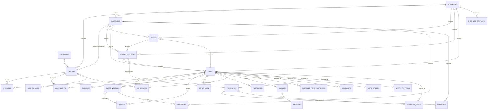

# KAAMFLOW database architecture

## Status

This is the architecture represented by the generated SQL in
`supabase/migrations/`. The migrations have **not** been applied or validated
against a Supabase database. The canonical migration review is
[KAAMFLOW_MIGRATION_SECURITY_REVIEW.md](./KAAMFLOW_MIGRATION_SECURITY_REVIEW.md).

## Relationship diagram

## Tables, keys, and purpose

All primary keys are UUIDs. Mutable records generally include `created_at`
and `updated_at`; event-like records retain a creation timestamp. A profile
ID is the matching Supabase Auth user ID. Business-owned records carry
`business_id`; composite `(business_id, id)` keys support tenant-safe
relationships.

| Table | Primary key | Main foreign keys and purpose |
| --- | --- | --- |
| `businesses` | `id` | Tenant/workspace root; unique slug. |
| `profiles` | `id` | `id → auth.users.id`; `business_id → businesses.id`; optional same-business customer link; role and active status. |
| `customers` | `id` | Business-owned customer contact record. |
| `assets` | `id` | Same-business customer-owned appliance/device. |
| `service_requests` | `id` | Business intake request; optional same-business customer, asset, and source follow-up; unique reference. |
| `jobs` | `id` | Business repair job; optional same-business request, customer, and asset. |
| `diagnoses` | `id` | Same-business job and optional technician; diagnosis/root-cause notes. |
| `evidence` | `id` | Same-business job and private Storage object metadata/path. |
| `quote_versions` | `id` | Same-business job; quote scope/price snapshot and version. |
| `quotes` | `id` | Same-business job, version, and optional customer; sent quote record. |
| `approvals` | `id` | Same-business quote version and customer; approval response. |
| `assignments` | `id` | Same-business job, technician, and assigning profile. |
| `repair_logs` | `id` | Same-business job and optional technician; timestamped repair actions. |
| `parts_used` | `id` | Same-business job; part, quantity, and cost. |
| `qc_records` | `id` | Same-business job and optional reviewer; inspection result/checklist. |
| `invoices` | `id` | Same-business job and optional quote version; invoice total/status. |
| `payments` | `id` | Same-business job, optional same-job invoice and recorder; amount/method plus unique business-scoped request key. |
| `customer_tracking_tokens` | `id` | Same-business job and optional creator; token digest/version, expiry, revocation. |
| `complaints` | `id` | Same-business job, optional customer and resolver; complaint/resolution notes. |
| `parts_orders` | `id` | Same-business job; procurement status and customer-visible ETA note. |
| `checklist_templates` | `id` | Business-owned diagnosis/QC checklist by category and type. |
| `warranty_terms` | `id` | Same-business job; warranty duration and terms. |
| `follow_ups` | `id` | Same-business job; scheduled customer follow-up. |
| `outcomes` | `id` | Same-business follow-up and customer; reported repair outcome. |
| `comeback_cases` | `id` | Same-business original job, customer, and optional follow-up. |
| `activity_logs` | `id` | Business audit trail and optional same-business actor. |
| `handover_payment_overrides` | `id` | Owner-only payment exception snapshot; reason, actor, invoice/balance snapshot, and one-time consumption. |
| `handover_transition_authorizations` | `id` | Private one-transaction authorization consumed by the job trigger for every `handover`/`closed` status transition. |

### Tenant-composite foreign keys

The core schema defines same-business composite references for its tenant-owned
relationships. The MVP migration adds same-business constraints for:

- Payments → same-business job, invoice belonging to that same job/business,
  and optional recorder profile. The payment FK uses
  `(business_id, job_id, invoice_id)`; a matching unique invoice key is added
  by the handover-guard migration.
- Tracking tokens → job and optional creator profile.
- Complaints → job, optional customer, and optional resolver profile.
- Parts orders → job.

Nullable references use column-specific `ON DELETE SET NULL` so deleting an
optional referenced record does not clear the tenant ID. Constraints are
added `NOT VALID` and then validated; incompatible legacy rows stop migration
execution rather than being rewritten or deleted. Confirm the disposable
database is PostgreSQL 15 or newer for this syntax.

## Important indexes

- Tenant composite unique keys support foreign-key validation and joins.
- Jobs: business/status/time and tenant-scoped customer, asset, and request
  lookup indexes.
- Service requests: tenant/time plus customer, asset, and source-follow-up
  indexes; normalized phone/time index for public intake throttling.
- Quote versions: tenant/job/version; approvals: tenant/status/time.
- Assignments: tenant/job and tenant/technician/status.
- Follow-ups and outcomes: tenant/status/due-time or response/time.
- Tracking tokens: unique token hash and active tenant/job/expiry lookup.
- Payments: unique `(business_id, payment_request_key)` and tenant/job/time
  and tenant/invoice/time indexes.
- Complaints and parts orders: tenant/job/time plus relevant status/customer
  indexes.
- Evidence, diagnoses, repair logs, parts, QC, invoices, warranties, and
  activity logs have tenant/job or tenant/time access indexes.

## Tenant isolation and authorization

1. A trusted provisioning process links an Auth UUID to exactly one business
   and role. Users cannot select or update their own tenant or role.
2. RLS is enabled in the migration for all 28 public tables. Policies derive
   tenant identity from `auth.uid()` and the active `profiles` row.
3. Roles currently supported by the app are `OWNER_ADMIN`, `DISPATCHER`,
   `TECHNICIAN`, `QC_REVIEWER`, and `CUSTOMER`. The requested Service Desk
   function maps to `DISPATCHER`; `SERVICE_DESK` is not a supported stored
   role.
4. Technicians access assigned jobs only. QC submission, payment recording,
   diagnosis, assignment, and other sensitive operations use role-checked
   RPCs. Payment table direct insert is revoked. Every transition to
   `handover` or `closed` requires a private, transaction-scoped authorization
   created by the role-checked transition RPC and consumed by the job trigger;
   direct authenticated status updates are rejected even when payment and QC
   requirements are satisfied.
5. Customers access a reduced repair summary, eligible quote versions, and
   controlled response RPCs; they do not receive internal notes or private
   evidence.
6. The evidence bucket is private. Storage object paths and evidence metadata
   are checked against the same business/job. Older file URLs are not
   migrated automatically.
7. Public intake is a narrowly scoped RPC with validation and a per-business,
   normalized-phone rate limit. This is not a substitute for edge/IP limits
   or CAPTCHA.
8. New tracking tokens contain 256 bits of random entropy; only a SHA-256
   digest is stored. Ambiguous pre-existing token values are not bulk hashed.
   The workflow RPC supports legacy version-0 values and upgrades a valid
   token to digest form when redeemed.
9. Browser, server, and `proxy.ts` share the public URL/key helper. It prefers
   `NEXT_PUBLIC_SUPABASE_PUBLISHABLE_KEY` and falls back to
   `NEXT_PUBLIC_SUPABASE_ANON_KEY`. Never use a service-role key in browser
   code.

## Verification state

This architecture is generated from code review, not live database
introspection. No migration, Auth sign-in, RLS policy, function, or workflow
has been verified against a disposable Supabase project. See
[KAAMFLOW_SUPABASE_VERIFICATION_REPORT.md](./KAAMFLOW_SUPABASE_VERIFICATION_REPORT.md)
for the current blockers.
