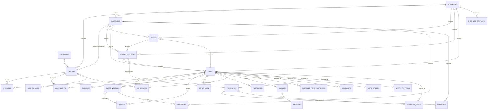

# KAAMFLOW database architecture

This is the KAAMFLOW relational design for Supabase PostgreSQL. Apply the
migrations in timestamp order:

1. [`20261116084000_kaamflow_core.sql`](../supabase/migrations/20261116084000_kaamflow_core.sql)
2. [`20261118090000_kaamflow_mvp_completion.sql`](../supabase/migrations/20261118090000_kaamflow_mvp_completion.sql)
3. [`20261118100000_kaamflow_workflow_hardening.sql`](../supabase/migrations/20261118100000_kaamflow_workflow_hardening.sql)

They are generated but have not been run against a Supabase project. The
dashboard uses authenticated database reads and does not present its sample
previews as live records.

## Relationship diagram

`business_id` is present on every business-owned table. The core migration
adds composite foreign keys pairing that ID with the referenced record ID on
the original core tables. The MVP migration adds same-business composite
foreign keys for payments, tracking tokens, complaints, and parts orders,
including nullable invoice/profile/customer references. Existing data is not
rewritten to satisfy these constraints: validation will stop the migration if
it finds cross-business references. These checks are generated SQL and have
not yet been run against a database.

## Tables and keys

All tables use UUID primary keys, `created_at` timestamps, and `updated_at`
timestamps on mutable records where applicable. Profile IDs are the matching
Supabase Auth user IDs.

| Table | Primary key | Foreign keys and purpose |
| --- | --- | --- |
| `businesses` | `id` | Tenant/workspace root; `slug` is unique. |
| `profiles` | `id` | `id → auth.users.id`; `business_id → businesses.id`; optional `(business_id, customer_id) → customers`. Holds one user's role. |
| `customers` | `id` | `business_id → businesses.id`; customer contact record. |
| `assets` | `id` | `business_id → businesses.id`; `(business_id, customer_id) → customers`; customer-owned appliance/device. |
| `service_requests` | `id` | `business_id → businesses.id`; optional same-business customer, asset, and source follow-up; intake request with unique reference. |
| `jobs` | `id` | `business_id → businesses.id`; optional same-business request, customer, and asset; repair status and handover timestamp. |
| `diagnoses` | `id` | `business_id, job_id → jobs`; optional same-business `technician_id → profiles`; technician findings. |
| `evidence` | `id` | `business_id, job_id → jobs`; private object metadata and Storage path. |
| `quote_versions` | `id` | `business_id, job_id → jobs`; price/scope snapshot, version unique per job. |
| `quotes` | `id` | `business_id, job_id → jobs`; same-business quote version and optional customer; delivery record. |
| `approvals` | `id` | `business_id, quote_version_id → quote_versions`; `business_id, customer_id → customers`; customer response to an exact version. |
| `assignments` | `id` | `business_id, job_id → jobs`; same-business technician and assigning profiles. |
| `repair_logs` | `id` | `business_id, job_id → jobs`; optional same-business technician; timestamped work notes/actions. |
| `parts_used` | `id` | `business_id, job_id → jobs`; part, quantity, and cost. |
| `qc_records` | `id` | `business_id, job_id → jobs`; optional same-business reviewer; pass/fail and checklist. |
| `invoices` | `id` | `business_id, job_id → jobs`; optional same-business quote version; manual payment status. |
| `payments` | `id` | Same-business `job_id`, optional `invoice_id`, and optional recorder profile; unique `(business_id, payment_request_key)` supports idempotent recording. |
| `customer_tracking_tokens` | `id` | Same-business job and optional creator; stores token digest, expiry, revocation time, and hash version. Legacy tokens are upgraded on successful use without bulk rehashing ambiguous legacy values. |
| `complaints` | `id` | `business_id, job_id → jobs`; optional customer; private complaint and resolution notes. |
| `parts_orders` | `id` | `business_id, job_id → jobs`; procurement status and customer-visible ETA note. |
| `checklist_templates` | `id` | Business-owned diagnosis and QC checklists by equipment category. |
| `warranty_terms` | `id` | `business_id, job_id → jobs`; business-entered warranty period and terms. |
| `follow_ups` | `id` | `business_id, job_id → jobs`; scheduled customer follow-up. |
| `outcomes` | `id` | `business_id, follow_up_id → follow_ups`; `business_id, customer_id → customers`; customer response, never treats `no_response` as success. |
| `comeback_cases` | `id` | `business_id, original_job_id → jobs`; same-business customer and optional follow-up; same-symptom return. |
| `activity_logs` | `id` | `business_id → businesses`; optional same-business actor profile; audit trail. |

## Important indexes

- Every tenant table carries `business_id`; composite unique keys on
  `(business_id, id)` support tenant-safe foreign keys. Common query paths are
  covered by the indexes in the migration.
- Jobs: `(business_id, status, created_at DESC)` for the active queue, plus
  tenant-scoped customer, asset, and request lookups.
- Requests: `(business_id, created_at DESC)` for recent intake, plus customer,
  asset, and source-follow-up lookups.
- Quote versions: `(business_id, job_id, version_number DESC)` for history.
- Quotes: `(business_id, job_id)` for delivered quote lookups.
- Tracking links: `(business_id, job_id, expires_at)` for active links; unique
  token digest index protects duplicate credentials.
- Approvals: `(business_id, status, created_at DESC)` for pending responses.
- Assignments: tenant-scoped job and `(business_id, technician_id, status)`
  indexes for assignments and technician workspaces.
- Follow-ups: `(business_id, status, due_at)` for due/overdue queues.
- Outcomes and comeback cases: tenant + response/status + time for FixLoop metrics.
- Evidence, diagnoses, repair logs, parts, QC, invoices, warranties, and
  activity logs have tenant/job or tenant/time indexes for common detail and
  audit queries. PostgreSQL does not automatically index referencing columns.

## Tenant isolation and RLS

1. A profile is provisioned for an authenticated Supabase Auth user and
   assigned to one `business_id` by a trusted process. A user must not choose
   or update their own role or tenant. A customer profile must be linked to
   its customer row before customer RPCs return data.
2. `private.current_business_id()` resolves the signed-in, active user's
   business through `profiles` and `auth.uid()`. Role and technician-assignment
   helpers also require an active profile. Helper functions are `SECURITY
   DEFINER` with a pinned empty `search_path`.
3. RLS is enabled for every business table. Owners and dispatchers manage
   business operations; technicians can access only assigned work; QC
   reviewers can read jobs and evidence in their business and submit QC only
   through the atomic inspection RPC. Policies are enforced by PostgreSQL, not
   just by UI visibility.
4. Customers have no direct access to internal tables. They can read a
   reduced repair summary and approved quotation information through security-definer
   RPCs, respond to a sent quotation version, and submit a follow-up outcome.
   The outcome RPC creates a comeback case only for `same_symptom`; a
   `different_issue` response requires a problem description and consent
   before it creates a new request.
5. Evidence uses the private `kaamflow-private-evidence` Storage bucket. Object
   paths begin with the business UUID and job UUID and must match an evidence
   metadata row. Customers cannot read internal notes or evidence. The
   migration does not move older `file_url` objects; review any previously
   stored files separately.
6. There is no anonymous table-insert policy. Public intake uses a narrowly
   scoped RPC, validates fields, requires a configured business slug, and
   applies a per-phone database rate limit. Do not expose internal notes or
   business selection through that RPC.
7. Activity logs are readable only by owners and written by database RPCs and
   triggers; direct client writes are not granted.
8. Payment creation is available only through an authenticated, role-checked
   atomic RPC. Direct payment inserts are revoked; a business-scoped request
   UUID prevents duplicate retries and rejects key reuse with a different
   payload.
9. New tracking links use cryptographically random bearer tokens; the database
   stores SHA-256 digests. Legacy rows remain marked version 0 and are safely
   matched and normalized only when the corresponding link is successfully used. Revoke
   exposed links and share the plaintext link only with the intended customer.
10. Never use a service-role key in browser code. It bypasses RLS and is not
   needed by the current browser/server SSR helpers.

The SQL and application workflow have been reviewed, but the migrations have
**not** been applied or validated against the live Supabase project. Review
each migration and test RLS with separate test users for every role before
storing real customer information.
